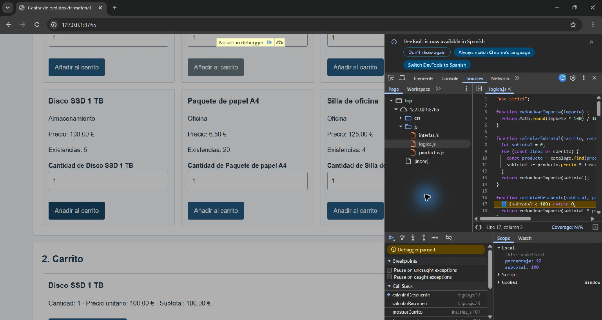
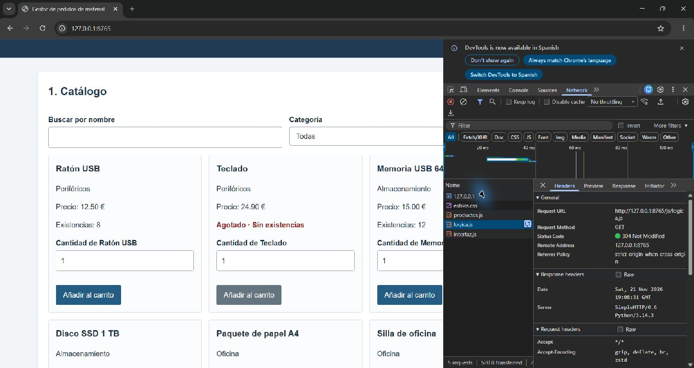

# Verificación de la práctica

Fecha: 21/11/2026. Verificaciones ejecutadas por el asistente, no atribuidas al alumno.

## Sintaxis y funcionamiento

Se han comprobado los tres scripts con `node --check`, sin errores. La aplicación no tiene un paso de compilación. Se ha ejecutado en Chrome mediante HTTP local en `127.0.0.1:8765`.

Las comprobaciones automatizadas del navegador cubrieron catálogo inicial, búsqueda combinada, filtros vacíos, producto agotado, cantidades vacías/negativas/decimales, stock insuficiente, acumulación sin duplicados, retirada, bloqueo de carrito vacío, importes por debajo/en/por encima del umbral, nombre en blanco, email inválido, códigos postales válidos e inválidos, limpieza de errores al cambiar la modalidad, contador de observaciones, confirmación, revalidación de stock, conservación de formulario, historial, IDs, exportación, límites de longitudes y reinicio al recargar.

Se comprobó expresamente la falta de cambios parciales simulando una reducción del stock antes de confirmar. También se verificó que dos pedidos no comparten las líneas del carrito y que el filtro del historial limita su contador e importe, pero no la exportación completa.

No se detectaron errores JavaScript ni advertencias de consola durante la batería. Se revisaron capturas de escritorio y móvil (390 px); no hay desbordamiento horizontal. Las capturas y el guion de comprobación del asistente se encuentran en `output/playwright/`, fuera del código de la aplicación. Playwright es una herramienta externa de verificación; no es una dependencia ni parte de los contenidos que necesita ejecutar el alumno.

## Evidencia de punto de interrupción

Se puso un punto de interrupción en la línea 17 de `js/logica.js`, dentro de `calcularDescuento`. Al añadir un disco SSD, la ejecución se detuvo antes de comprobar el umbral. Scope mostró `subtotal: 100` y `porcentaje: 10`. La pila incluye `calcularDescuento`, `calcularResumen` y `mostrarCarrito`.

La condición `subtotal < 100` es falsa con 100, por lo que se calcula el descuento. Después de reanudar se observó: `Unidades: 1 · Subtotal: 100.00 € · Descuento: 10.00 € · Total: 90.00 €`. Esto comprueba que el umbral incluye exactamente 100 €.

El punto se instaló mediante la herramienta de automatización del depurador y la captura se tomó en la interfaz real de DevTools. No se añadió ninguna instrucción `debugger` al código entregado. El README explica cómo repetirlo manualmente.

## Evidencia de carga HTTP

La pestaña Network muestra el fichero `logica.js` solicitado por GET a `http://127.0.0.1:8765/js/logica.js`, servido por el servidor HTTP local de Python. La respuesta capturada es `304 Not Modified`: el navegador revalidó el recurso y utilizó el contenido que ya había descargado. Es una respuesta HTTP correcta, no un error de carga. Con la caché desactivada o en una primera visita se espera `200 OK`.

## Comprobaciones manuales del autor

Repetir los casos del README, especialmente la modificación del stock antes de confirmar y el cambio envío → recogida. Para la defensa, explicar el punto de interrupción con los valores observados y reproducir una prueba válida y otra inválida. No se ha probado en todos los navegadores.

## Preparación del repositorio

El 21/11/2026 se ha configurado `https://github.com/alvarops11/practica_dwec_2.git` como remoto `origin`, por petición del usuario. La rama es `main`. Se incluyen código, documentación, temario y capturas de evidencias. `.gitignore` excluye `.playwright-cli/`, `tmp/` y `output/`, que contienen archivos temporales y herramientas de comprobación del asistente. No se ha modificado la lógica de la aplicación para esta publicación.

`.gitattributes` conserva los PDF y PNG como binarios y normaliza los saltos de línea de los archivos de texto a LF. Se han retirado tres espacios finales del documento de conceptos, sin cambiar su contenido.
